<!-- README.md: Interactive/modern profile for Ahmed (AI & Cybersecurity) -->

  

<h2 align="center">Hey — I’m Ahmed 👋</h2>

<em>AI researcher and cybersecurity enthusiast building practical, secure AI-powered tools and demos.</em>

  <a href="https://github.com/ahmed2bassam/AIPCC" title="AIPCC">AIPCC</a>
  &nbsp;&nbsp;•&nbsp;&nbsp;
  <a href="https://github.com/ahmed2bassam/crimson-stream" title="crimson-stream">crimson-stream</a>
  &nbsp;&nbsp;•&nbsp;&nbsp;
  <a href="https://github.com/ahmed2bassam/EncryptionWeb-app" title="EncryptionWeb-app">EncryptionWeb-app</a>
  &nbsp;&nbsp;•&nbsp;&nbsp;
  <a href="https://github.com/ahmed2bassam/UniLink" title="UniLink">UniLink</a>

### About

I build AI-first applications and experiment with practical cybersecurity tools. My focus areas:

- AI/ML applied to security automation and decision support
- Secure-by-design engineering for web and cloud apps
- Learning and teaching cryptography fundamentals through interactive demos

### Projects

- AIPCC — https://github.com/ahmed2bassam/AIPCC
- crimson-stream — https://github.com/ahmed2bassam/crimson-stream
- EncryptionWeb-app — https://github.com/ahmed2bassam/EncryptionWeb-app
- UniLink — https://github.com/ahmed2bassam/UniLink

### Connect

- LinkedIn: [Ahmed Said](https://www.linkedin.com/in/ahmed-said-878820252)
- Email: ahmed2bassam@gmail.com

---

Made with ❤️ — contact me if you'd like to collaborate on AI or security projects.
